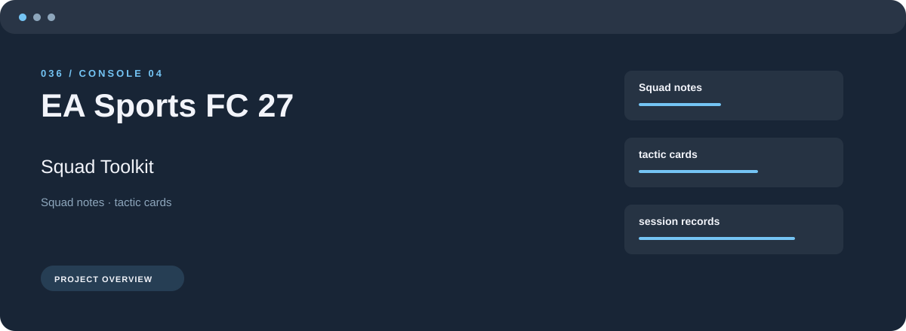
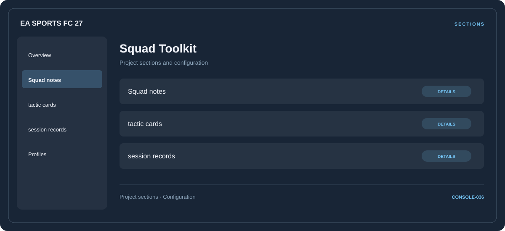

# 🛠️ EA Sports FC 27 Squad Toolkit

**Squad notes · Tactic cards · Session records**

## ⚡ Features

Start with squad notes, organize tactic cards, and keep session records close at hand. These are the main areas covered by EA Sports FC 27 Squad Toolkit.

### ⚙️ Squad notes

Character or team groups presented with the context needed to organize a session.

### 🧩 Tactic cards

A dedicated section for tactic cards and the configuration details associated with that area.

### ⌨️ Session records

Session and activity information grouped by the task or context it belongs to.

## 🖥️ Project navigation

## 📥 Download

The button and cover open the project's download page. Use the information supplied with the downloaded package for installation and release-specific requirements.

## 📚 Project documentation

- [Feature reference](docs/FEATURES.md)
- [Download information](docs/DOWNLOAD.md)
- [Project page](index.html)

---

EA Sports FC 27 Squad Toolkit · Program documentation and download information.
